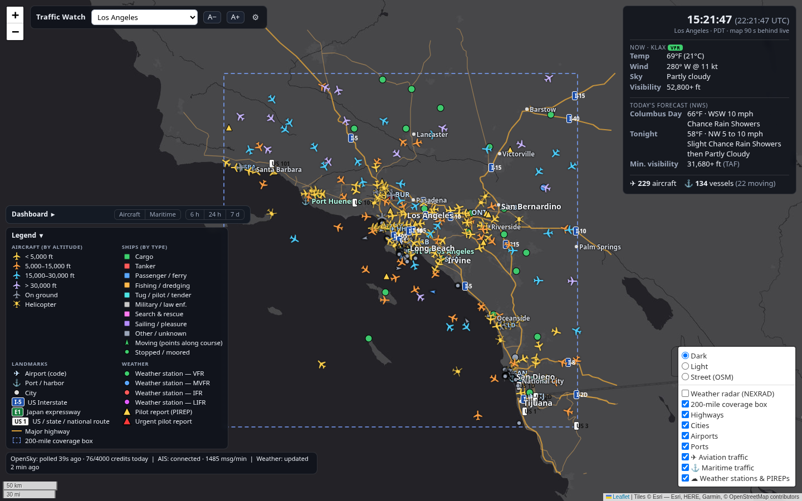

# Traffic Watch

A Linux desktop map of live air and sea traffic around 56 ports in the US and
Japan. Each port gets a 200 × 200 mile view with aircraft (OpenSky Network),
ships (AISStream.io), airport weather and the day's forecast, plus a small
dashboard of traffic over time.

- Aircraft coloured by altitude and ships coloured by type; click any of them
  for airline/operator, model, registration, flag and links to FlightAware,
  ADS-B Exchange, VesselFinder and MarineTraffic.
- Local time (24 h) with UTC, current conditions and the day's forecast.
- Toggleable layers: aircraft, ships, weather stations and pilot reports, radar.
- Dashboard: pie charts of aircraft by altitude, airline share (top 8 airlines)
  and manufacturer, and of ships by type and flag registry; plus aircraft in
  the area and moving ships over time (6 h / 24 h / 7 d).
- Ports: US West Coast, Alaska, Hawaii, Gulf Coast, Southeast Atlantic,
  Northeast and Mid-Atlantic, Great Lakes, and Japan.

## Install (Ubuntu / Debian)

1. Download the latest `traffic-watch-<version>.zip` from the
   [Releases](../../releases) page and unzip it where you want the app to live.
2. In that folder run:

       ./install.sh

   If system packages are missing, the installer prints the exact
   `sudo apt install …` line to run, then run `./install.sh` again.
3. Open **Traffic Watch** from your app menu.

Fedora and Arch work too; the installer prints their package names.
To remove it, run `./uninstall.sh` and delete the folder.

## API keys, or no keys

On first launch Traffic Watch opens a setup page. Each source is optional:

| | With a free key | Without a key |
|---|---|---|
| **Aircraft** (OpenSky Network) | Live, refreshed about every 40 s | Snapshot of the area on screen every 60 min (15, 30 or 120 min selectable), within OpenSky's 400 anonymous requests a day |
| **Ships** (AISStream.io) | Live | Not available: there is no keyless source of live ship positions |
| **Weather, maps, forecasts** | — | Always keyless |

Getting the keys (both free):

- **OpenSky:** create an account at [opensky-network.org](https://opensky-network.org/),
  then on your account page create an **API client** and copy its client ID and secret.
- **AISStream:** sign in with GitHub at [aisstream.io](https://aisstream.io/) and create an **API key**.

The setup page has a **Test** button for each key. Keys are stored only on
your computer, in `~/.config/traffic-watch/keys.env` (readable by your user
only). Change them any time with the ⚙ button on the map.

## Good to know

- The map is drawn 90 seconds behind real time, as specified.
- Coverage depends on volunteer receivers: some areas (Cook Inlet, New
  Orleans/Mobile, Kyushu, Okinawa) get few or no ships, and OpenSky sees fewer
  aircraft over Japan than over the US.
- With keys, the port on screen refreshes every ~40 s; other ports refresh in
  the background as OpenSky's free daily allowance permits.
- Ship operators are guessed from ship names and are labelled "(inferred)".
- The over-time charts keep 7 days, recorded while Traffic Watch runs. To keep
  recording with the window closed, turn on **Background recording** on the ⚙
  setup page: it runs a small systemd user service (`traffic-watch-collector`)
  that the map window connects to when you open it. It keeps using your OpenSky
  allowance and the ship feed around the clock; turn it off on the same page.
  Gaps in the lines are times nothing was recording.

## For developers

    python3 -m venv .venv && .venv/bin/pip install -r requirements.txt
    .venv/bin/python app.py            # app window
    .venv/bin/python app.py --browser  # or in a web browser

Keys can also go in a `.env` file in the app folder (see `.env.example`).

| Piece | File |
|---|---|
| Ports, groups, 200-mile boxes | `config/ports.yaml`, `trafficwatch/config.py` |
| OpenSky poller (keyed and anonymous) | `trafficwatch/opensky.py` |
| AIS websocket | `trafficwatch/ais.py` |
| Weather (METAR/TAF/PIREP, NWS, Open-Meteo) | `trafficwatch/weather.py` |
| Aircraft/ship details | `trafficwatch/enrich.py` |
| 90 s delay + dead reckoning | `trafficwatch/store.py` |
| Dashboard history (SQLite) | `trafficwatch/history.py` |
| Background collector | `app.py --headless`, `trafficwatch/setup.py` |
| First-run key setup | `trafficwatch/setup.py`, `trafficwatch/static/setup.html` |
| Base maps (folium) | `trafficwatch/basemap.py` |
| Live layers, legend, popups | `trafficwatch/static/live.js` |
| Dashboard charts | `trafficwatch/static/dashboard.js` |
| Local server / app window | `trafficwatch/server.py`, `app.py` |
| Reference data builder | `scripts/build_reference.py` |
| Release build + secret scan | `scripts/make_release.sh` |

**Adding a port:** add an entry to `config/ports.yaml`, list its group under
`regions:`, run `scripts/build_reference.py`, restart. Keep each group's
combined box under 25 sq deg (1 OpenSky credit per poll); the app warns if not.
Ports outside the US need `country:` so forecasts come from Open-Meteo.

## Changelog

**1.0.3**
- Over-time charts fixed: aircraft are recorded right when an area is polled
  (no more false zeros), ship counts only once the ship feed has warmed up
  (no more dips after each launch), and lines break where nothing was recording.
  Existing history is migrated and its bad points removed.
- Optional background recording (systemd user service) so history keeps
  building while the window is closed; the window attaches to it.
- Pie charts for altitude, airline share (now current, top 8 airlines),
  manufacturer, ships by type and flag registries.
- History database: separate aircraft/ship tables, WAL mode. These are all done to ensure that you can track the numbers over 7 days consistently instead of patchily with previous versions. 

**1.0.2**
- Dashboard above the legend: Aircraft (aircraft over time, altitude,
  airline share over time, manufacturer) and Maritime (ships by type, moving
  ships over time, flag registries), with 6 h / 24 h / 7 d ranges.
- First-run setup page for API keys, with key tests; keys saved outside the app folder.
- No-key mode: anonymous OpenSky snapshots (hourly by default), ships hidden
  with a prompt, weather refreshed hourly.
- Installer checks system packages; uninstaller; MIT license and data notices.

**1.0.1**
- Readable port dropdown, map legend, click-for-details cards with outside links.
- Aircraft airline/model/registration/owner; ship type/flag/inferred operator.
- 16 Japanese ports with Open-Meteo forecasts and RainViewer radar.

**1.0.0**
- 40 US ports, live aircraft and ships, weather panel and layers, 90 s delay.

## License

Code: MIT (see `LICENSE`). Data and services: see `NOTICE`.
